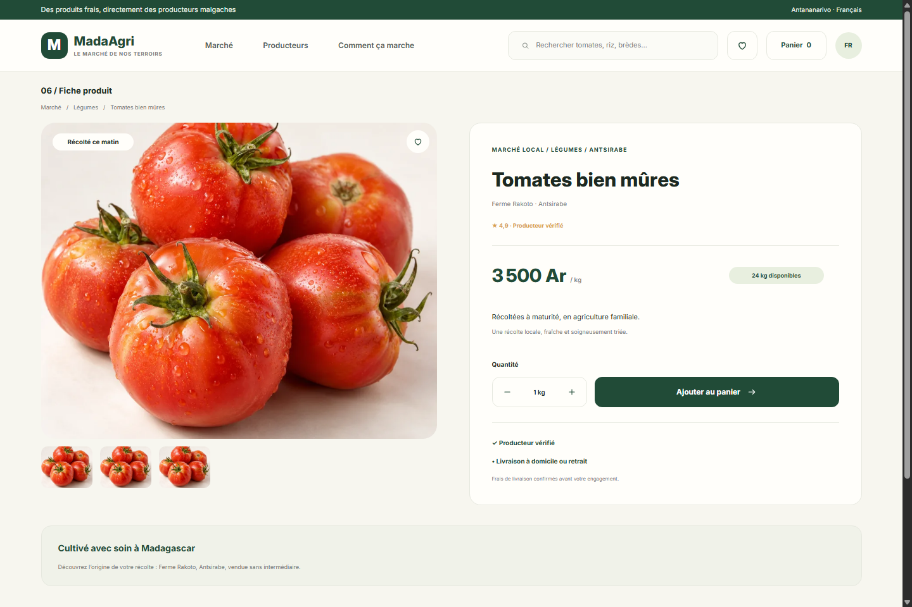
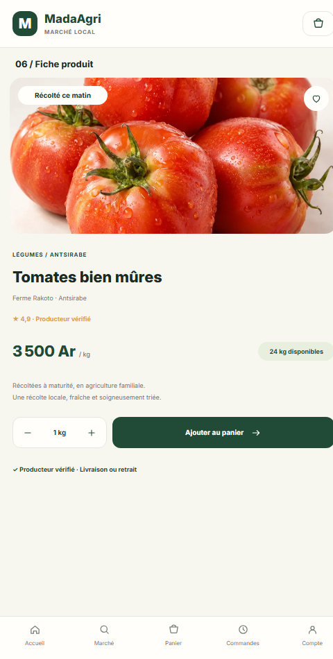

# MadaAgri Market

A local marketplace connecting buyers with Malagasy agricultural producers.

The web interface is currently in French; this project guide and feature overview are in English.

## Screenshots

<table>
  <tr>
    <th>Desktop (1440 × 960)</th>
    <th>Mobile (480 × 950)</th>
  </tr>
  <tr>
    <td></td>
    <td></td>
  </tr>
</table>

## Features

- Responsive marketplace with product search, category filters, sorting, product details, and producer information.
- Buyer and producer accounts, six-digit phone verification, shopping cart, order requests, order tracking, and notifications.
- Delivery workflow: producers propose delivery fees; buyers accept or decline; orders then move through preparation, delivery, and handover.
- Producer dashboard for recent orders and product management, including stock updates, photo uploads, edits, and product deactivation.
- Product photos support PNG, JPEG, and WebP files up to 2 MB.
- Administration tools for account verification and suspension, categories, units, delivery areas and fees, product moderation, complaints, and CSV export.
- Buyer reviews and complaints after delivery.
- Separate order and payment statuses, manual payment confirmation with a receipt reference, and a history of decisions.

## Requirements

- Python 3
- Node.js 20 or later

## Run locally

Build the frontend, then start the Python server:

```bash
cd frontend
npm install
npm run build
cd ..
python server.py --demo
```

Open [http://127.0.0.1:8000](http://127.0.0.1:8000).

Demo accounts:

- Buyer: `acheteur@madaagri.test` / `acheteur123`
- Producer: `producteur@madaagri.test` / `producteur123`
- Cooperative: `coop@madaagri.test` / `coop12345`
- Producer: `lalao@madaagri.test` / `lalao12345`
- Farm: `soa@madaagri.test` / `fermesoa123`
- Administrator: `admin@madaagri.test` / `admin123`

Demo mode also seeds three products and three producer accounts awaiting verification, so the administration area has sample records to review.

## Frontend development

Run the Python server on port 8765 in one terminal:

```bash
python server.py --demo --port 8765
```

In a second terminal, start Vite:

```bash
cd frontend
npm run dev
```

Open [http://localhost:5173](http://localhost:5173). Vite proxies `/api` and `/assets` requests to the Python server on port 8765.

## Main routes

`/`, `/connexion`, `/inscription`, `/mot-de-passe`, `/verification`, `/produit/:id`, `/panier`, `/livraison`, `/paiement`, `/confirmation/:id`, `/commandes/:id`, `/commandes`, `/producteur`, `/admin`, `/admin/commandes`, `/admin/catalogue`, and `/admin/parametres`.

The interface follows the design boards in `figma-import/` (1440 × 960 desktop and 390 × 844 mobile). Theme colors and breakpoints are defined in `frontend/src/index.css`; page components are in `frontend/src/pages/`.

## Data and limitations

- Local data is stored in `madaagri.sqlite3`. Accounts created in the app remain on this machine.
- The server exposes the built frontend and `assets/`; the SQLite database and source code are not available to the browser.
- The older framework-free interface is kept in `legacy-vanilla/` for reference and is no longer served.
- Online payments, SMS, email, and automatic delivery-fee calculation are not configured. An order is a request to the producer; the site does not charge a payment. Delivery fees and the final amount are confirmed before the order is finalized.
- Password-reset and phone-verification codes are displayed only in demo mode. Outside demo mode, those flows require an email or SMS provider.
- Before public deployment, configure HTTPS, email, privacy and terms pages, delivery policies, and payment providers.

## Verify

```bash
npm --prefix frontend run build
python -m unittest discover -s tests -v
```
